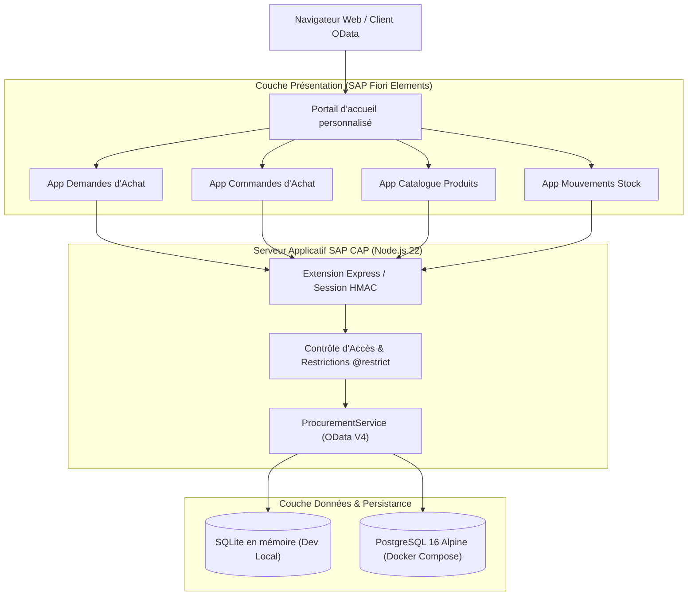
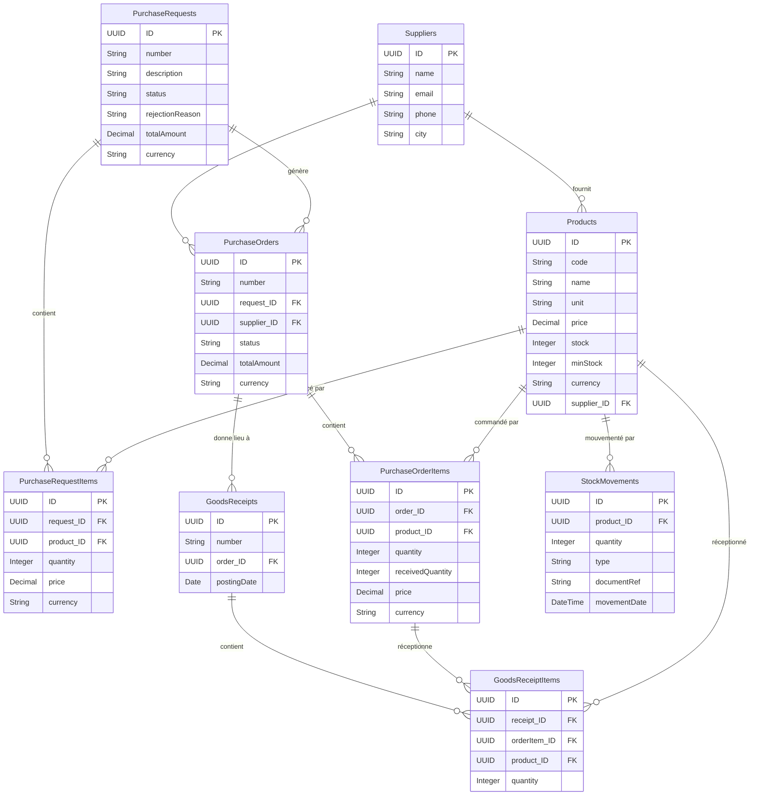
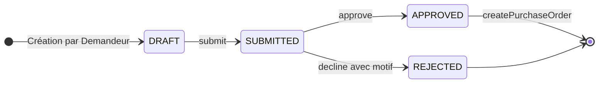
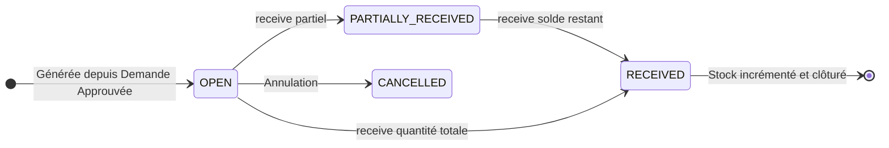

# SAP CAP Procure-to-Pay

[](https://github.com/Houssam265/sap-cap-procure-to-pay/actions/workflows/ci.yml)

Application d'entreprise modélisant le cycle complet d'achats Procure-to-Pay (P2P), de l'expression du besoin à la réception magasin et la mise à jour des stocks.
Conçue selon les standards du Cloud Application Programming Model (CAP) Node.js et servie via des interfaces SAP Fiori Elements (OData V4).
Déployable en conteneur sécurisé (Docker multi-stage, PostgreSQL 16) ou sur environnement cloud d'entreprise SAP BTP.

### Technologies Utilisées

- **Backend** : [SAP Cloud Application Programming Model (CAP)](https://cap.cloud.sap) (`@sap/cds` v10, Node.js 22, ECMAScript Modules).
- **Frontend** : SAP Fiori Elements (OData V4, SAPUI5), portail d'accueil personnalisé avec barre de navigation personnalisée et sélecteur de persona.
- **Bases de données** : SQLite en mémoire (`@cap-js/sqlite` en développement local), PostgreSQL 16 Alpine (`@cap-js/postgres` en conteneur Docker).
- **Qualité & Tests** : tests d'intégration (cds.test, runner natif de Node.js), ESLint v10, Prettier v3, scripts de validation bout-en-bout PowerShell (`test-e2e.ps1`).
- **CI/CD & DevOps** : GitHub Actions (matrice Lint, Format, Test, Coverage, Docker Buildx cache, E2E Compose & Standalone), Dependabot.
- **Sécurité** : Contrôle d'accès basé sur les rôles (RBAC `@restrict`), session signée HMAC-SHA256 (`HttpOnly`, `SameSite=Lax`), protection anti-redirection ouverte, neutralisation stricte _fail-closed_ en production.

---

## 1. Fonctionnalités Métier

- **Cycle Demande d'Achat (PR)** : Saisie multi-articles avec devises, calcul automatique et instantané du montant total de la demande, numérotation séquentielle lisible (`PR-100x`).
- **Workflow d'Approbation & Refus motivé** :
  - Soumission par le demandeur (`DRAFT` $\rightarrow$ `SUBMITTED`).
  - Validation managériale (`SUBMITTED` $\rightarrow$ `APPROVED`).
  - Rejet managérial avec motif obligatoire consigné dans la demande (`SUBMITTED` $\rightarrow$ `REJECTED`).
- **Génération automatique des Commandes (PO)** : Découpage intelligent des lignes de la demande d'achat validée en commandes distinctes par fournisseur (`PO-100x`).
- **Réception Magasin & Suivi des Reliquats** :
  - Prise en charge des réceptions partielles et totales avec contrôle strict anti-sur-réception (rejet en erreur 400).
  - Évolution dynamique du statut de commande (`OPEN` $\rightarrow$ `PARTIALLY_RECEIVED` $\rightarrow$ `RECEIVED`).
- **Mise à jour Atomique du Stock & Audit Trail** :
  - Incrément atomique et transactionnel du stock produit (`stock += quantité`) lors de la validation du bon de réception (`GR-100x`).
  - Enregistrement chronologique inaltérable dans l'historique des mouvements de stock (`StockMovements` de type `IN`).
- **Contrôle d'Accès par Rôles & Isolation des Données (Ownership)** :
  - **Demandeur (`Requester`)** : Crée, modifie et soumet ses propres demandes. Isolation stricte garantie au niveau données (`where: 'createdBy = $user'`) : un demandeur ne peut ni voir ni altérer les demandes d'un autre utilisateur.
  - **Manager (`Manager`)** : Supervision globale de toutes les demandes, approbation, rejet motivé, génération des commandes fournisseurs.
  - **Magasinier (`Warehouse`)** : Consultation des commandes d'achat, saisie des réceptions partielles/totales, traçabilité des stocks.
  - **Administrateur (`Admin`)** : Gestion complète du catalogue d'articles et du référentiel fournisseurs.
- **4 Applications SAP Fiori Elements** :
  1. _Demandes d'Achat_ (`purchase-requests`) : Liste filtrée, fiche détaillée, boutons d'action conditionnés par le statut.
  2. _Commandes d'Achat_ (`purchase-orders`) : Suivi des statuts de livraison, dialogue de réception magasin.
  3. _Catalogue Produits_ (`products`) : Inventaire, indicateur critique de stock bas (`stock < minStock`).
  4. _Mouvements de Stock_ (`stock-movements`) : Registre d'audit chronologique des entrées magasin.
- **Internationalisation & Messages Métier** : Messages d'information, de validation et d'erreurs rédigés intégralement en français (`_i18n/messages_fr.properties`).

---

## 2. Architecture Technique

### Vue d'Ensemble des Composants



### Modèle de Données (9 Entités CDS — [db/schema.cds](db/schema.cds))



### Cycles de Vie et Machines à États

#### Cycle de la Demande d'Achat (PurchaseRequest)



#### Cycle de la Commande Fournisseur (PurchaseOrder)



---

## 3. Guide de Démarrage Rapide

### Prérequis

- [Node.js](https://nodejs.org/) v20+ (v22 recommandé)
- [Docker Engine & Compose](https://docs.docker.com/) (pour exécution conteneurisée)
- PowerShell (Windows) ou Bash (Linux/macOS)

### Développement Local (SQLite en mémoire)

1. **Installation des dépendances** :

   ```bash
   npm install
   ```

2. **Lancement du serveur de développement CAP** :

   ```bash
   npx cds watch
   # ou alternativement : npm start
   ```

3. **Accès applicatif** :
   - Portail d'accueil personnalisé : [http://localhost:4004](http://localhost:4004)
   - Métadonnées OData V4 : [http://localhost:4004/odata/v4/procurement/$metadata](http://localhost:4004/odata/v4/procurement/$metadata)

4. **Comptes de test pré-configurés (Auth Mock en dev/demo)** :
   | Utilisateur | Mot de passe | Rôle Métier                  | Périmètre & Droits                                           |
   | :---------- | :----------- | :--------------------------- | :----------------------------------------------------------- |
   | `alice`     | `alice`      | **Demandeur** (`Requester`)  | Création & soumission de ses propres demandes                |
   | `dave`      | `dave`       | **Demandeur** (`Requester`)  | Deuxième demandeur (vérification de l'isolation des données) |
   | `bob`       | `bob`        | **Manager** (`Manager`)      | Approbation / refus motivé, génération des commandes         |
   | `carol`     | `carol`      | **Magasinier** (`Warehouse`) | Réception des marchandises, consultation des stocks          |
   | `admin`     | `admin`      | **Administrateur** (`Admin`) | Maintenance complète du référentiel (produits, fournisseurs) |

### Exécution des Tests

```bash
# 1. Tests d'intégration (cds.test, runner natif de Node.js)
npm test

# 2. Mesure de couverture de code (sans les fichiers de test)
node --test --experimental-test-coverage "--test-coverage-exclude=test/**" test/*.test.js

# 3. Tests bout-en-bout (API E2E avec PowerShell, serveur actif sur le port 4004)
pwsh scripts/test-e2e.ps1 -BaseUrl http://localhost:4004
```

### Déploiement Conteneurisé (Docker & PostgreSQL)

Le projet intègre une configuration conteneurisée prête à l'emploi associant l'application CAP compilée en conteneur sécurisé multi-stage et une base PostgreSQL 16 Alpine.

```bash
# Démarrage de la stack PostgreSQL + Application en mode démo sécurisé
docker compose up -d --wait

# Exécution des tests E2E sur l'environnement conteneurisé
pwsh scripts/test-e2e.ps1 -BaseUrl http://localhost:4004

# Arrêt et nettoyage de la stack
docker compose down -v
```

> Consultez le guide complet d'architecture et de sécurité conteneurisée dans [docs/docker.md](docs/docker.md).

---

## 4. Qualité Logicielle et Sécurité

### Dispositif Qualité Validé

- **Tests d'intégration (cds.test, runner natif de Node.js)** : **34 tests automatisés passants** (10 suites, 0 échec, 0 ignoré).
- **Scénarios End-to-End (E2E)** : Suite automatisée `scripts/test-e2e.ps1` exécutant **plus de 35 assertions** réparties en 7 sections (sécurité HTTP, contrôle RBAC, cycle complet P2P, règles d'intégrité, réceptions partielles/totales, validation anti-redirection ouverte, résistance aux cookies falsifiés/expirés).
- **Analyse statique et style** :
  - `ESLint v10` : 0 erreur, 0 avertissement (`npm run lint`).
  - `Prettier v3` : code source 100% conforme aux règles de mise en page (`npm run format:check`).
- **Pipeline CI/CD (GitHub Actions)** :
  - Job `Quality` : exécution de lint, prettier, tests et extraction de couverture sur Node.js 22.
  - Job `Docker Build` : construction de l'image de production avec Docker Buildx et cache GitHub Actions.
  - Job `E2E` : validation sur Docker Compose (PostgreSQL) et sur conteneur isolé _fail-closed_.
- **Maintenance continue** : `Dependabot` configuré pour des revues hebdomadaires automatisées des dépendances npm, des actions GitHub et de l'image Docker de base.

### Métriques Réelles de Couverture de Code

Mesure exacte obtenue via `node --test --experimental-test-coverage "--test-coverage-exclude=test/**" test/*.test.js` sur les composants métier (hors code de test) :

| Fichier Source                                                                | Couverture Lignes | Couverture Branches | Couverture Fonctions |
| :---------------------------------------------------------------------------- | :---------------: | :-----------------: | :------------------: |
| [srv/procurement-service.js](srv/procurement-service.js) (Logique métier P2P) |    **84.82%**     |     **42.38%**      |      **80.77%**      |
| [srv/server.js](srv/server.js) (Session HMAC & Sécurité)                      |    **81.16%**     |     **55.00%**      |      **84.00%**      |
| **All files (Ensemble des services)**                                         |    **83.17%**     |     **47.97%**      |      **82.35%**      |

_Note de transparence sur les branches_ : Le taux de branches (47.97% sur l'ensemble) s'explique par la présence de mécanismes de défense en profondeur (gardes de sécurité multi-profils, cas d'erreurs techniques défensifs et vérifications de sécurité actives uniquement sous certains profils cloud).

### Sécurité Applicative & Principe _Fail-Closed_

- **Mode démo désactivé par défaut** : En production (`NODE_ENV=production`), les endpoints de bascule de rôle rapide (`/api/switch`) et de connexion mockée (`/api/login`) sont neutralisés et répondent strictement par une erreur **HTTP 404 Not Found**.
- **Signature cryptographique des sessions** : Cookie de session `ptp_auth` scellé par signature HMAC-SHA256 avec validation à temps constant (`crypto.timingSafeEqual`) pour prévenir les attaques temporelles. Attributs `HttpOnly` et `SameSite=Lax` activés.
- **Protection Anti-Open Redirect** : Validation rigoureuse de la cible de redirection sur `/login` pour interdire toute redirection vers des domaines externes malveillants (`http://`, `//evil.com`, etc.).
- **Isolation des conteneurs** : Exécution de l'image Docker sous l'utilisateur non privilégié `node` (UID/GID 1000) et isolation totale du port PostgreSQL au sein du réseau Docker interne.

---

## 5. Limites Connues et Perspectives d'Évolution

- **Déploiement SAP BTP non finalisé** : Faute de compte d'essai actif accessible sur la plateforme SAP BTP (services Trial temporairement indisponibles), le déploiement sur Kyma / Cloud Foundry avec base SAP HANA Cloud n'a pas été réalisé en environnement réel.
- **Authentification XSUAA / IAS** : La configuration déclarative CAP pour SAP Cloud Identity Services / XSUAA est présente (`[production].auth.kind = "xsuaa"`), mais n'a pas pu être testée avec un Identity Provider (IdP) cloud réel.
- **Persistance en développement local** : En développement pur sans conteneur, SQLite s'exécute en mémoire éphémère (les données sont réinitialisées à chaque relance de `cds watch`).
- **Tests d'interface (UI) automatisés** : Les tests automatisés actuels couvrent rigoureusement les couches API, OData et logique métier ; l'ajout de tests UI end-to-end via SAP WDI5 ou Playwright constitue la suite logique pour automatiser les tests d'écran Fiori Elements.

---

## 6. Captures d'Écran et Démonstration Vidéo

Les captures illustrant chaque étape du cycle métier sont référencées dans le dossier [docs/screenshots/](docs/screenshots/) :

1. [Portail d'accueil personnalisé & Sélecteur de persona](docs/screenshots/01-portail-accueil.png)
2. [Création et soumission de la demande d'achat (Alice - Demandeur)](docs/screenshots/02-pr-creation-alice.png)
3. [Approbation managériale et boîte de dialogue de refus (Bob - Manager)](docs/screenshots/03-pr-approval-bob.png)
4. [Génération automatique des commandes découpées par fournisseur](docs/screenshots/04-po-split-supplier.png)
5. [Réception magasin partielle / totale et reliquat (Carol - Magasinier)](docs/screenshots/05-goods-receipt-carol.png)
6. [Audit trail des mouvements de stock et inventaire actualisé](docs/screenshots/06-stock-movements-history.png)

> **Démonstration Vidéo** : à renseigner.

---

## 7. Structure du Répertoire

```text
sap-cap-procure-to-pay/
├── .github/
│   ├── dependabot.yml          # Mises à jour automatisées hebdomadaires
│   └── workflows/ci.yml        # Pipeline CI/CD GitHub Actions multi-jobs
├── _i18n/                      # Traductions i18n globales et messages CDS
├── app/                        # Couche Présentation (SAP Fiori Elements & Portail)
│   ├── index.html              # Portail d'accueil personnalisé
│   ├── shellbar.js             # Barre de navigation personnalisée avec sélecteur de rôle
│   ├── annotations.cds         # Annotations UI Fiori Elements (@UI.LineItem, etc.)
│   ├── products/               # Fiori Elements App : Catalogue Produits
│   ├── purchase-requests/      # Fiori Elements App : Demandes d'Achat
│   ├── purchase-orders/        # Fiori Elements App : Commandes Fournisseurs
│   └── stock-movements/        # Fiori Elements App : Mouvements de Stock
├── db/                         # Couche Domaine & Persistance
│   ├── schema.cds              # Modélisation des 9 entités CDS du domaine P2P
│   └── data/                   # Jeux de données d'initialisation (.csv)
├── docs/                       # Documentation technique & démonstration
│   ├── docker.md               # Guide d'architecture et de déploiement Docker
│   ├── demo.md                 # Guide pas à pas de démonstration (2 minutes)
│   └── screenshots/            # Emplacement des captures d'écran du flux
├── scripts/                    # Scripts d'automatisation et de validation
│   ├── init-db.js              # Initialisation idempotente du schéma PostgreSQL
│   └── test-e2e.ps1            # Suite de validation bout-en-bout (API & Sécurité)
├── srv/                        # Services Métier & Logique Applicative
│   ├── _i18n/                  # Messages métier localisés en français
│   ├── procurement-service.cds # Définition OData V4 et autorisations (@restrict)
│   ├── procurement-service.js  # Handlers événementiels (actions, atomic stock)
│   └── server.js               # Extension Express (session HMAC, routes démo/prod)
├── test/                       # Tests automatisés
│   ├── auth-session.test.js    # Tests de sécurité de session et cookies HMAC
│   ├── security.test.js        # Tests de contrôle d'accès RBAC et validations
│   ├── workflow.test.js        # Tests du cycle complet Procure-to-Pay
│   └── helpers.js              # Utilitaires de test
├── Dockerfile                  # Construction d'image Docker sécurisée multi-stage
├── docker-compose.yml          # Orchestration PostgreSQL 16 + Application
├── eslint.config.mjs           # Configuration ESLint v10
├── package.json                # Dépendances et scripts du projet
└── readme.md                   # Ce guide de documentation
```

---

## 8. Licence

Ce projet est distribué sous licence MIT. Le fichier `LICENSE` sera ajouté dès confirmation du nom complet du titulaire.
